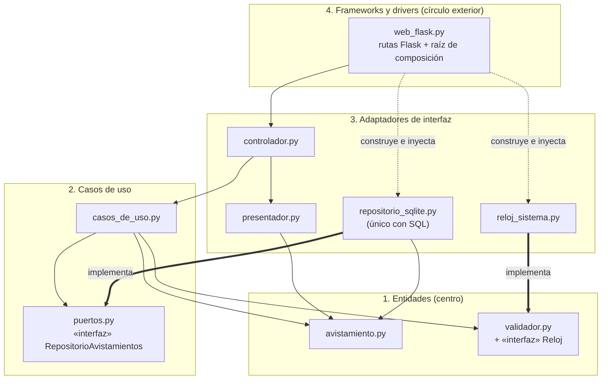

# Taller 5: Clean Architecture y arquitectura hexagonal

**Asignatura:** Ingeniería de Software 2 (ISW-2) · **Fecha:** miércoles 11 de noviembre de 2026
**Autor:** Juan David Peña Cubillos · Universidad El Bosque

**Repositorio:** https://github.com/JU4ND4VID/api-avistamientos
**Rama con los cambios:** `refactor/clean-architecture`

---

## Parte 1. Investigación

### 1. El problema de Cockburn, los puertos y los adaptadores, y la simetría

El problema que Cockburn ve en las aplicaciones de su época es que la lógica de negocio termina filtrándose en el código de la interfaz de usuario y quedando amarrada a los dispositivos y bases de datos con los que la aplicación se ejecuta. Esto trae dos consecuencias: la aplicación solo se puede manejar desde su interfaz gráfica, y es difícil probarla de forma automática sin tener todo lo externo montado (Cockburn, 2005).

Su propuesta es que la aplicación pueda ser manejada por igual por una persona, otro programa, una prueba automática o un script, y que se pueda desarrollar y probar aislada de sus dispositivos y bases de datos reales (Cockburn, 2005).

- **Puerto:** es el punto de entrada o de salida de la aplicación, definido por el propósito de la conversación que se tiene con el exterior (por ejemplo, "guardar avistamientos"), no por una tecnología (Cockburn, 2005).
- **Adaptador:** es la pieza que traduce entre lo que habla un dispositivo concreto (una petición HTTP, una prueba, una base de datos) y lo que espera el puerto. Un mismo puerto puede tener varios adaptadores, y se cambia uno por otro sin tocar el interior (Cockburn, 2005).
- **Simetría:** el lado del usuario y el lado de la base de datos parecen distintos (a uno lo llama el mundo, el otro lo llama la aplicación), pero Cockburn observa que en ambos casos se trata de un actor externo conectado al núcleo mediante un puerto y un adaptador. Por eso los trata igual y dibuja un lado "que maneja" y otro "que es manejado" de una misma forma (Cockburn, 2005).

### 2. Los círculos de Clean Architecture y la regla de dependencia

De adentro hacia afuera, según Martin (2012):

1. **Entities (entidades):** reglas de negocio generales; son lo que menos cambia cuando algo externo cambia.
2. **Use Cases (casos de uso):** reglas propias de la aplicación; coordinan el flujo de datos hacia y desde las entidades.
3. **Interface Adapters (adaptadores de interfaz):** convierten los datos al formato cómodo para los círculos internos y al que piden la base de datos o la web (controladores, presentadores, y el código SQL).
4. **Frameworks & Drivers:** el círculo exterior con la base de datos y el framework web; es poco código de "pegamento".

La **regla de dependencia** dice que las dependencias del código fuente solo pueden apuntar hacia adentro (Martin, 2012). Lo que prohíbe es que algo de un círculo interno conozca algo de uno externo: no puede nombrar clases, funciones ni variables declaradas afuera, ni usar formatos de datos que vengan de un framework (Martin, 2012). Resumido con una frase suya: los círculos externos son mecanismos y los internos son políticas (Martin, 2012).

### 3. Cómo se resuelve que el caso de uso necesite la base de datos

La contradicción es aparente: el control del programa va hacia afuera (el caso de uso llama a guardar), pero el código fuente solo puede apuntar hacia adentro. Martin la resuelve con inversión de dependencias: el caso de uso llama a una interfaz declarada en su propio círculo, y la clase concreta que la implementa vive en un círculo exterior; así el flujo de control y la dirección de las dependencias quedan en sentidos opuestos (Martin, 2012). Es el principio de inversión de dependencias que vimos en SOLID. Además, entre círculos solo cruzan datos simples y aislados, no filas de base de datos (Martin, 2012).

**Ejemplo en nuestra API.** `RegistrarAvistamiento` (caso de uso) necesita guardar. En vez de importar `sqlite3`, usa la interfaz `RepositorioAvistamientos`, que está en `application/puertos.py`. La clase `RepositorioSqlite`, en `adapters/`, la implementa con SQL. El caso de uso solo recibe "algo que cumple la interfaz" por el constructor, y quien lo conecta es `web_flask.py`. Por eso las pruebas de los casos de uso (`tests/test_casos_de_uso.py`) corren con un repositorio en memoria, sin SQLite ni Flask.

### 4. Hexagonal, cebolla y Clean Architecture: qué tienen en común y qué cambia

**En común.** Las tres ponen la lógica de negocio en el centro y empujan hacia el borde la interfaz de usuario, la base de datos y el framework, de modo que el núcleo no dependa de ellos; usan interfaces definidas por el núcleo e implementadas afuera (inversión de dependencias); y buscan poder probar el negocio sin la infraestructura (Cockburn, 2005; Palermo, 2008; Martin, 2012). El propio Martin presenta su propuesta como una de varias con el mismo objetivo, la separación de responsabilidades, y menciona a la hexagonal y a la de cebolla entre ellas (Martin, 2012).

**Qué cambia.**

| | Hexagonal (Cockburn, 2005) | Cebolla (Palermo, 2008) | Clean Architecture (Martin, 2012) |
|---|---|---|---|
| Vocabulario | puertos y adaptadores | capas de la cebolla, modelo de dominio al centro | círculos: entidades, casos de uso, adaptadores, frameworks |
| Número de capas | no prescribe capas internas: hay un "adentro" y un "afuera" conectados por puertos | un núcleo con un número variable de capas intermedias alrededor del modelo de dominio | cuatro círculos nombrados (aclara que el número puede variar) |
| Énfasis | la simetría entre actores que manejan y actores manejados; probar sin el exterior | controlar el acoplamiento; la base de datos "no es el centro, es externa"; las interfaces de repositorio dentro del núcleo | una sola regla (dependencias hacia adentro), casos de uso como círculo propio y reglas sobre los datos que cruzan los límites |

En resumen, cambia sobre todo el vocabulario y cuánto detalle estructural se prescribe; el principio de fondo es el mismo (Cockburn, 2005; Palermo, 2008; Martin, 2012).

### 5. ¿Se justifica Clean Architecture en una API pequeña?

**Posición:** para esta API, con seis endpoints y una regla de validación, *no* se justifica por sí sola como decisión de producción; sí se justifica un núcleo mínimo (separar validación y casos de uso del framework, y poner el repositorio detrás de una interfaz). Los cuatro círculos completos son, en este tamaño, más ceremonia que beneficio.

**Costo concreto (medido en este refactor).** El código fuente pasó de 2 archivos y 128 sentencias (`app.py` + `validador.py`) a 12 archivos con código y 277 sentencias medidas (sin contar el lanzador `app.py`), más del doble, para exactamente las mismas respuestas. Hay más archivos que abrir para seguir una petición (ruta → controlador → caso de uso → repositorio → presentador) y varias clases que casi solo delegan. Si el sistema no crece, ese esfuerzo no se recupera: es lo que se suele llamar sobreingeniería.

**Beneficio concreto (también medido).** La lógica de negocio ahora se prueba sin Flask ni base de datos: las 9 pruebas de `test_casos_de_uso.py` y las 6 de `test_controlador.py` corren con dobles en memoria, y la prueba `test_arquitectura.py` verifica automáticamente que el dominio no importe Flask ni `sqlite3`. Además, cambiar SQLite por otra base solo exigiría escribir otro adaptador que cumpla `RepositorioAvistamientos` (Cockburn, 2005; Palermo, 2008).

**Por qué esta posición.** El beneficio solo se cobra si el sistema cambia o crece (más reglas, otra base de datos, otro canal además de HTTP); el costo se paga desde el primer día. Si la API va a seguir siendo así de pequeña, bastaría la separación mínima; si se espera que crezca, la inversión ya hecha se compensa. Como ejercicio de aprendizaje, el refactor vale la pena porque obliga a ver dónde estaban mezcladas las responsabilidades.

### Referencias

- Cockburn, A. (2005). *Hexagonal architecture*. https://alistair.cockburn.us/hexagonal-architecture/
- Martin, R. C. (2012, 13 de agosto). *The Clean Architecture*. The Clean Code Blog. https://blog.cleancoder.com/uncle-bob/2012/08/13/the-clean-architecture.html
- Palermo, J. (2008, julio). *The Onion Architecture: part 1*. https://jeffreypalermo.com/2008/07/the-onion-architecture-part-1/

---

## Parte 2. Aplicación

### Arquitectura elegida: Clean Architecture (Martin, 2012)

Se aplicó Clean Architecture con sus cuatro círculos y su nomenclatura, sin mezclar vocabulario de las otras dos (no hay "puertos de entrada/salida" de Cockburn ni "capas de servicios" de Palermo; la interfaz del repositorio se llama puerto solo porque es el término que Martin usa para los *output ports* en su artículo).

### Estructura de carpetas

```
app.py                              # lanzador: crear_app().run()
avistamientos/
├── domain/                         # 1. Entidades
│   ├── avistamiento.py             #    entidad Avistamiento
│   └── validador.py                #    regla de validación + interfaz Reloj
├── application/                    # 2. Casos de uso
│   ├── casos_de_uso.py             #    Listar, Obtener, Registrar, Actualizar, Eliminar, Resumir
│   ├── puertos.py                  #    interfaz RepositorioAvistamientos
│   ├── errores.py                  #    DatosInvalidos, AvistamientoNoEncontrado
│   └── dto.py                      #    ResumenEspecie
├── adapters/                       # 3. Adaptadores de interfaz
│   ├── controlador.py              #    HTTP (datos simples) -> caso de uso
│   ├── presentador.py              #    resultado -> RespuestaHttp (estado + cuerpo)
│   ├── repositorio_sqlite.py       #    implementa el puerto; único con SQL
│   └── reloj_sistema.py            #    implementa Reloj con date.today()
└── frameworks/                     # 4. Frameworks y drivers
    └── web_flask.py                #    rutas Flask + raíz de composición (crear_app)
tests/                              # pruebas originales + pruebas nuevas por círculo
scripts/muestra_api.py              # muestra determinista de respuestas (antes/después)
docs/                               # evidencias, diagrama y este documento
```

### Diagrama de la dirección de las dependencias



Las flechas continuas son "importa / depende de" y todas apuntan hacia el centro. Las flechas gruesas muestran la inversión de dependencias: `RepositorioSqlite` y `RelojSistema` (afuera) implementan interfaces que pertenecen a círculos internos, no al revés. Las punteadas indican que `web_flask.py`, la raíz de composición, es el único que conoce las clases concretas y las inyecta. La regla se verifica automáticamente en `tests/test_arquitectura.py`.

### Historial de commits (rama `refactor/clean-architecture`)

1. Estado inicial: API del taller de pruebas (antes del refactor)
2. docs: evidencia del "antes" (pruebas, cobertura y muestra de la API)
3. refactor(dominio): mueve el validador al círculo de dominio
4. feat(aplicación): entidad, casos de uso y puerto del repositorio
5. feat(adaptadores): repositorio SQLite que implementa el puerto
6. feat(adaptadores): controlador y presentador sin dependencia de Flask
7. refactor(frameworks): Flask pasa al círculo exterior y app.py queda mínimo
8. test(arquitectura): verifica la regla de dependencia leyendo los imports
9. docs: evidencia del "después", diagrama y documento del taller

En todos los commits las pruebas pasan.

### Evidencia de funcionamiento y cobertura

Salida completa en `docs/evidencia-antes.txt` y `docs/evidencia-despues.txt`.

| | Antes | Después |
|---|---|---|
| Pruebas | 34 pasan | **61 pasan** (las 34 originales siguen pasando + 27 nuevas) |
| Cobertura (líneas y ramas) | 97 % (128 sentencias, 4 sin cubrir) | **99 %** (277 sentencias, 1 sin cubrir) |
| Líneas sin cubrir | `GET /`, el bloque `if __name__` y `Reloj.hoy` | solo `GET /` (`web_flask.py`, línea 47) |
| Muestra de la API | `docs/evidencia-antes.txt` | **idéntica** (`diff` sin diferencias) |

Salida resumida de las pruebas después del refactor:

```
$ python -m pytest --cov=avistamientos --cov-branch --cov-report=term-missing
collected 61 items
...
TOTAL    277    1    22    0    99%
============================== 61 passed ==============================
```

Muestra de que la API responde igual (fragmento; el `diff` completo entre las dos muestras no arroja diferencias):

```
POST /avistamientos (válido)
  -> 201 {"especie": "colibrí", "fecha": "2026-09-29", "id": 1, "lugar": "Jardín Botánico", "observador": "Peña"}
POST /avistamientos (incompleto)
  -> 400 {"detalles": {"fecha": "debe tener el formato AAAA-MM-DD", "lugar": "no puede estar vacío", "observador": "no puede estar vacío"}, "error": "Datos inválidos en: fecha, lugar, observador"}
PUT /avistamientos/999 (inexistente, cuerpo inválido)
  -> 404 {"error": "Avistamiento no encontrado"}
DELETE /avistamientos/2
  -> 204
```

**Qué se tocó de las pruebas originales.** Solo las líneas de importación de `test_validador.py` (el validador cambió de carpeta) y el *fixture* de `test_api.py` (antes reemplazaba la variable global `DB_PATH`; ahora crea la app con `crear_app(ruta_temporal)`). Ninguna aserción cambió.

### Lo más difícil de separar

Lo más difícil fue separar el **orden oculto de las comprobaciones dentro de los endpoints**, sobre todo en `PUT`: el código original primero abría la conexión y buscaba el avistamiento (respondiendo 404 si no existía) y solo después validaba el cuerpo (400). Esa regla no estaba escrita en ninguna parte, solo estaba implícita en el orden de las líneas de la función de Flask, mezclada con SQL. Al llevarla al caso de uso `ActualizarAvistamiento` hubo que descubrirla y conservarla expresamente (hay una prueba que lo fija: un `PUT` a un id inexistente con cuerpo inválido responde 404, no 400).

Tres cosas más costaron trabajo, por la misma razón (el framework y la base de datos estaban entremezclados con las reglas):

- **El reloj por defecto del validador.** `ValidadorDeAvistamiento()` se creaba solo con `RelojSistema`, es decir, el círculo interno dependía de una implementación concreta de afuera. Hubo que quitar ese valor por defecto y pasarlo por inyección.
- **Las filas de SQLite como formato de respuesta.** `dict(fila)` convertía directo la fila de la base en JSON; ahora la fila se traduce a la entidad dentro del repositorio y el presentador arma el JSON.
- **El `DB_PATH` global.** Las pruebas lo reemplazaban con `monkeypatch`; para no depender de una variable global se creó `crear_app(ruta_db)`, que es también la raíz de composición.

### Cómo ejecutar

```
python -m pip install -r requirements-dev.txt
python -m pytest -v
python -m pytest --cov=avistamientos --cov-branch --cov-report=term-missing
python app.py
```
